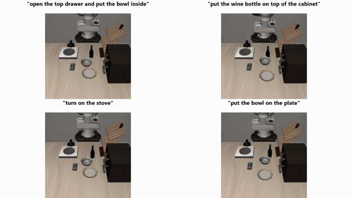
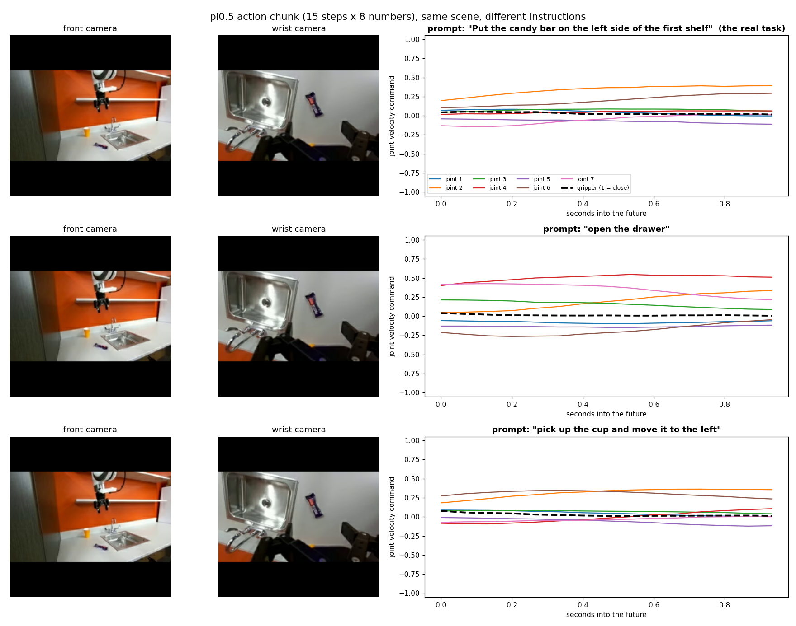
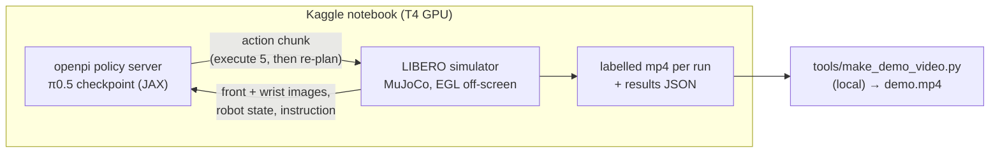

# π0.5 robot demo: running a vision-language-action model on a free GPU

I ran **π0.5**, Physical Intelligence's open-source robot foundation model, myself on a **free Kaggle T4 GPU**, and tested it in a robot simulator and on real robot camera frames. Same kitchen, different sentence, different job:



**26 / 26 simulated tasks succeeded**, including instructions reworded in ways it was not trained on. I built this as the live demo for my paper presentation on π0.5 in *CSE 598: Deep Learning* at ASU, and I also report where it falls short.

| | |
|---|---|
| **Paper** | [π0.5: a Vision-Language-Action Model with Open-World Generalization](https://arxiv.org/abs/2504.16054) (Physical Intelligence, 2025) |
| **Model code** | [Physical-Intelligence/openpi](https://github.com/Physical-Intelligence/openpi) (checkpoints `pi05_libero`, `pi05_droid`) |
| **Simulator** | [LIBERO](https://github.com/Lifelong-Robot-Learning/LIBERO), LIBERO-Goal suite |
| **Hardware** | Kaggle notebook, 1× NVIDIA T4 (16 GB), no local GPU needed |
| **Full video** | [`media/demo.mp4`](media/demo.mp4) (32 s) |

---

## π0.5 in 60 seconds

A **vision-language-action (VLA)** model takes camera images and an instruction and outputs robot motions. The paper's main ideas:

- **Co-training on mixed data.** One model learns from mobile-robot data, other robots, web data (captions, VQA), subtask labels, and verbal coaching, all turned into tokens in one sequence. In the paper, 97.6% of first-phase training examples do *not* come from mobile robots doing household tasks.
- **Two training stages.** In **pre-training**, actions are compressed into discrete **FAST** tokens, which are efficient to train. **Post-training** adds a small (~300M-parameter) **action expert** that uses **flow matching** to turn noise into smooth, continuous motion in 10 steps, which is fast enough for real time.
- **Think, then act.** At run time the same model first predicts a subtask in words ("pick up the pillow"), then the actions for it.
- **Result.** The paper reports the first end-to-end learned robot to clean kitchens and bedrooms in homes that were not in its training data.

## What I ran

### 1. LIBERO simulation: does it follow the instruction?
Every LIBERO-Goal task uses **the same kitchen scene**, so the only thing that changes between tasks is the sentence.

| Test | Runs | Successes | Mean control steps |
|---|---|---|---|
| **A.** 10 official instructions × 2 trials | 20 | **20** | 111 |
| **B.** Reworded instructions × 2 trials | 6 | **6** | 94 |

Reworded examples: *"turn on the stove"* → *"switch the stove on"*, *"put the bowl on the plate"* → *"place the bowl onto the plate"*, *"open the middle drawer of the cabinet"* → *"pull open the cabinet's middle drawer"*.

### 2. DROID frames: what is inside the "brain"?
I gave the `pi05_droid` checkpoint real robot camera frames with three different instructions and plotted the **action chunk** it predicts (15 future steps × 7 joint velocities + gripper).



To check that the instruction really changes the plan, I compared how much the chunk varies **between instructions** with how much it varies when the **same** instruction is repeated (the model samples from noise):

| Scene | Spread, same prompt | Difference, between prompts | Ratio |
|---|---|---|---|
| 1. marker in pot | 0.047 | 0.082 | 1.7× |
| 2. candy bar on shelf | 0.048 | 0.157 | 3.3× |
| 3. sachet in bowl | 0.067 | 0.129 | 1.9× |
| 4. doritos in sink | 0.039 | 0.035 | 0.9× |

In 3 of 4 scenes the instruction clearly changes the plan. In scene 4 it doesn't. Speed on the T4: model load 35 s, first inference 10.3 s (JIT compile), then about **2.0 s per call**.

## How it works



- [`kaggle/orchestrate.py`](kaggle/orchestrate.py) is the entry point. It clones openpi, installs it with `uv`, downloads checkpoints, runs the DROID demo, sets up LIBERO in its own Python 3.8 env, starts the policy server, and runs the rollouts. Each stage logs separately, so one failure doesn't kill the rest.
- [`kaggle/libero_demo.py`](kaggle/libero_demo.py) runs the simulation rollouts. It is adapted from openpi's `examples/libero/main.py`.
- [`kaggle/droid_demo.py`](kaggle/droid_demo.py) runs the action-chunk experiment on frames from `lerobot/droid_100`.
- [`kaggle/build.py`](kaggle/build.py) inlines the two demo scripts into one `run_all.py`, because a Kaggle script kernel is a single file.
- [`notebooks/explore_results.ipynb`](notebooks/explore_results.ipynb) summarizes everything in `results/`, on CPU only.
- [`tools/make_demo_video.py`](tools/make_demo_video.py) stitches the rollout videos into the 32-second demo.

### Reproduce
```bash
cd kaggle
python build.py                      # -> run_all.py
# put your own Kaggle username in kernel-metadata.json ("id"), then:
kaggle kernels push -p .             # needs GPU + internet enabled (set in kernel-metadata.json)
kaggle kernels output <you>/pi05-demo -p out/
```

## Engineering notes: what broke and how I fixed it
My first Kaggle run failed and used about 5 GPU-hours. The fixes:

| Problem | Cause | Fix |
|---|---|---|
| `uv` installed into the wrong Python (3.13) and a dependency failed to build | Kaggle sets `UV_SYSTEM_PYTHON` | Remove it from the environment and use `uv sync --python 3.11` |
| Checkpoint download failed | openpi uses `gsutil`, which needs compiled `crcmod` for hash checks | Pre-fetch with `gsutil -o 'GSUtil:check_hashes=never'` |
| Simulation client hung for hours | It waited forever on a policy server that had crashed | Poll port 8000 and only start rollouts once the server is up |
| No display for rendering | Headless GPU machine | MuJoCo with `MUJOCO_GL=egl`, with an OSMesa fallback |

## Limitations (honest version)
- **Simulation, in-distribution.** `pi05_libero` was fine-tuned on LIBERO, so 26/26 shows *language following*, not the paper's headline claim of generalizing to new real homes.
- **No high-level "think" step.** The open-source checkpoints output actions only, not the subtask text, so the paper's two-level inference isn't shown here.
- **DROID caveats.** `droid_100` is part of DROID, which `pi05_droid` was trained on. That dataset stores Cartesian state, so I used the Franka ready pose as the joint state. This experiment shows sensitivity to the instruction, not task success.
- **Small sample.** 2 trials per task, and no failures were observed, so this doesn't estimate a failure rate.

## Credits
- **π0.5** and **openpi**: Physical Intelligence ([paper](https://arxiv.org/abs/2504.16054), [code](https://github.com/Physical-Intelligence/openpi), Apache-2.0). `kaggle/libero_demo.py` is adapted from openpi's LIBERO example.
- **LIBERO**: Liu et al., *LIBERO: Benchmarking Knowledge Transfer for Lifelong Robot Learning*, NeurIPS 2023 Datasets & Benchmarks.
- **DROID** frames via [`lerobot/droid_100`](https://huggingface.co/datasets/lerobot/droid_100) on Hugging Face.
- I used Claude (Anthropic) as an AI assistant while building and debugging this project.

## License
My code is released under the [MIT License](LICENSE). Code adapted from openpi remains under its original Apache-2.0 license.
